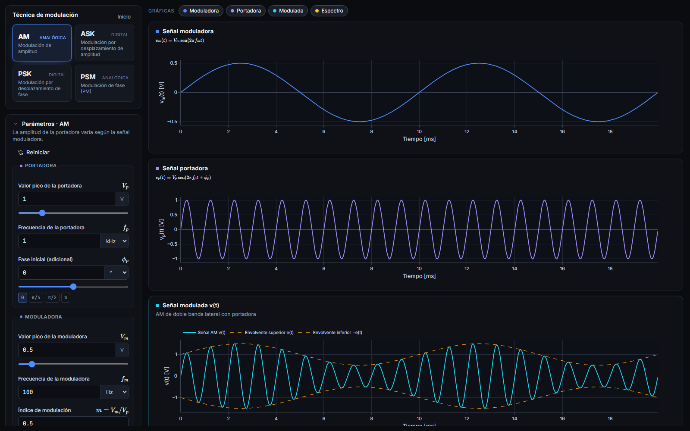
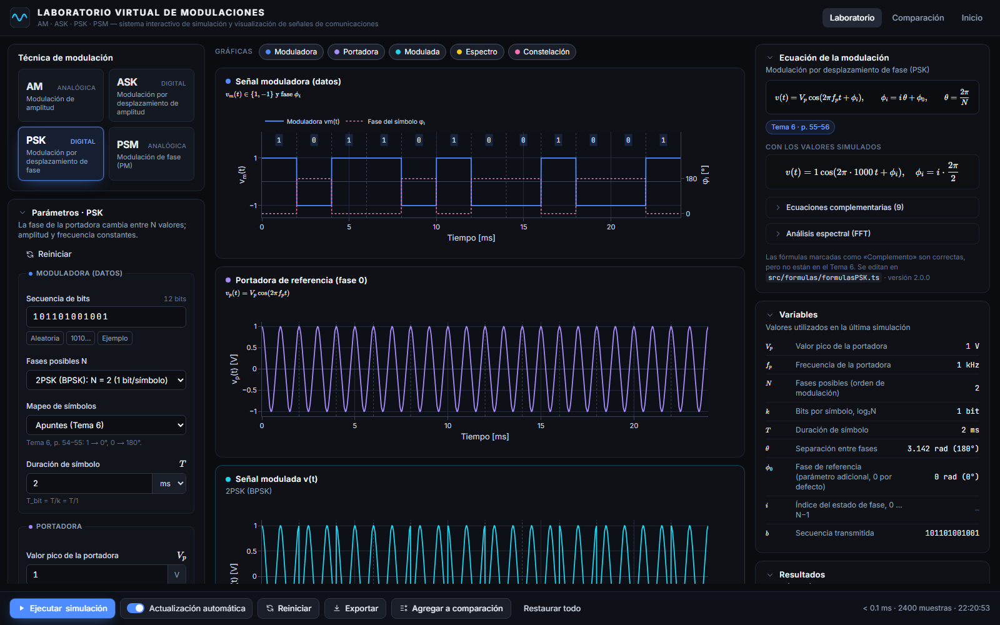

<div align="center">


# Laboratorio Virtual de Modulaciones

Simula y visualiza modulaciones **AM**, **ASK**, **PSK** (2PSK, 4PSK, 8PSK, 16PSK) y **PSM** (modulación de fase) con las fórmulas del Tema 6 del curso.<br />
Las señales se calculan muestra a muestra a partir de sus ecuaciones y se muestran en el tiempo, en frecuencia (FFT) y en el plano I/Q.

**[Abrir el laboratorio en línea →](https://laboratorio-modulaciones.vercel.app/laboratorio)** · [laboratorio-modulaciones.vercel.app](https://laboratorio-modulaciones.vercel.app)


</div>



### Abrir una técnica directamente

| Técnica | Qué se ve | Enlace |
|---|---|---|
| **AM** | Envolvente, sobremodulación, portadora y frecuencias laterales | [`/laboratorio?tecnica=AM`](https://laboratorio-modulaciones.vercel.app/laboratorio?tecnica=AM) |
| **ASK** | Portadora presente o ausente, amplitud por bit, espectro sen x/x | [`/laboratorio?tecnica=ASK`](https://laboratorio-modulaciones.vercel.app/laboratorio?tecnica=ASK) |
| **PSK** | Saltos de fase, señal multinivel, constelación I/Q | [`/laboratorio?tecnica=PSK`](https://laboratorio-modulaciones.vercel.app/laboratorio?tecnica=PSK) |
| **PSM** | Fase proporcional a la moduladora, índice β, banda angosta y ancha | [`/laboratorio?tecnica=PSM`](https://laboratorio-modulaciones.vercel.app/laboratorio?tecnica=PSM) |



## Puesta en marcha

Requiere Node.js 20 o superior.

```bash
git clone https://github.com/RafaelC26/laboratorio-modulaciones.git
```

```bash
cd laboratorio-modulaciones
```

```bash
npm install
```

```bash
npm run dev
```

Abra http://localhost:3000 y pulse **Entrar al laboratorio** (o vaya directamente a `/laboratorio`).

### Despliegue

El proyecto está conectado a Vercel: cada `git push` a `main` publica una nueva versión en https://laboratorio-modulaciones.vercel.app (las demás ramas generan vistas previas).

Otros comandos:

| Comando | Qué hace |
|---|---|
| `npm test` | Ejecuta las pruebas matemáticas (`src/pruebas`). |
| `npm run typecheck` | Verifica los tipos de TypeScript. |
| `npm run build` y `npm start` | Compila y sirve la versión de producción. |

## Qué permite hacer

- Elegir la técnica y configurar sus parámetros con validación en vivo (campos con unidades Hz/kHz/MHz, s/ms/µs, °/rad).
- Ver la señal moduladora (o la secuencia digital), la portadora y la señal modulada, con zoom sincronizado entre las tres. Todo se recalcula solo al cambiar un parámetro.
- AM: envolvente, porcentaje de modulación M y zonas de **sobremodulación** marcadas en rojo cuando M > 100 %.
- PSK: moduladora bipolar o multinivel, fase de cada símbolo, etiquetas de bits, **constelación** y mapeo seleccionable (apuntes, Gray o binario).
- PSM: índice β, banda angosta o ancha, frecuencia instantánea y espectro de Bessel.
- Espectro de la señal modulada por FFT exacta de N puntos (radix-2 o Bluestein), en escala lineal o dB, con **marcadores teóricos** para contrastar.
- Descargar cada gráfica como PNG con el icono de cámara de la propia gráfica.
- Historial de simulaciones anteriores (guardado en el navegador).

## Fórmulas del Tema 6

Las ecuaciones siguen los apuntes del curso (*Tema 6. Representación de información*) y usan su notación. Las páginas son las impresas al pie del documento.

| Técnica | Portadora | Moduladora | Señal modulada | Pág. |
|---|---|---|---|---|
| **AM** | `Vp·sen(2π fp t)` | `Vm·sen(2π fm t)` | `Vp[1 + m·sen(2π fm t)]·sen(2π fp t)`, con `m = Vm/Vp` | 35–36 |
| **ASK** | `Vp·sen(2π fp t)` | 1 para un "1", 0 para un "0" | `Vp·vm(t)·sen(2π fp t)` | 49–50 |
| **2PSK** | `Vp·cos(2π fp t)` | 1 para un "1", −1 para un "0" | `vp(t)·vm(t)`: fase 0 para un "1", fase π para un "0" | 54–55 |
| **MPSK** | `Vp·cos(2π fp t)` | señal multinivel | fases separadas `θ = 2π/N`, `Vt = (1/T)·log₂N`, `BW = 1/T` | 55–58 |
| **PSM (PM)** | `Vp·cos(2π fp t)` | `Vm·sen(2π fm t)` | `Vp·cos[2π fp t + β·sen(2π fm t)]`, con `β = ΔΦ·Vm` | 47–48 |

En `src/formulas/`, cada fórmula indica su página del Tema 6 en `paginaTema6`. Las que no la tienen son complementos que no están en los apuntes:

- **Parámetros:** la fase inicial `φp` y la fase de referencia `φ0`, que valen 0 por defecto, y las amplitudes `A1` y `A0` libres en ASK (con `A1 = Vp` y `A0 = 0` se obtiene la expresión del Tema 6).
- **AM:** `Pp = Vp²/2R`, la eficiencia y la envolvente como curva.
- **ASK:** `BW = 2/Tbit`, la energía por bit y la profundidad de modulación.
- **PSK:** las componentes I/Q, la distancia mínima, la energía, la eficiencia espectral y el mapeo Gray.
- **PSM:** la frecuencia instantánea, las rayas de Bessel y la regla de Carson.
- **Análisis:** la FFT y el criterio `fs ≥ 10·fmax`.

## Dónde se cambian las fórmulas

Cada técnica tiene su archivo en `src/formulas/`. Ahí están **juntas** las funciones que se calculan y las ecuaciones LaTeX que se muestran:

| Técnica | Archivo |
|---|---|
| Portadora | `src/formulas/formulasPortadora.ts` |
| AM | `src/formulas/formulasAM.ts` |
| ASK | `src/formulas/formulasASK.ts` |
| PSK | `src/formulas/formulasPSK.ts` |
| PSM | `src/formulas/formulasPSM.ts` |
| Espectro (FFT, ventanas, normalización) | `src/formulas/formulasEspectro.ts` |

Para modificar, por ejemplo, la ecuación de AM, se edita `senalModuladaAM` y la definición `formulasAM.principal.ecuacion` en `formulasAM.ts`. No hace falta tocar componentes de React ni gráficas.

### Sobre PSM

En este curso, PSM es la **modulación de fase analógica**, que el Tema 6 llama PM (p. 46):

```
v(t) = Vp · cos[2π fp t + ΔΦ · vm(t)],   vm(t) = Vm · sen(2π fm t),   β = ΔΦ · Vm
```

Es de banda angosta si `β < π/2`, y entonces `BW = 2 fm` (p. 45 y 48).

Sus ecuaciones están en `src/formulas/formulasPSM.ts`; las señales auxiliares que se dibujan (frecuencia instantánea) salen de `src/motores/MotorModulacionPSM.ts`.

## Convenciones matemáticas

- Unidades internas SI: s, Hz, V, rad. Potencias normalizadas a R = 1 Ω.
- Muestreo: `t_n = t_0 + n/f_s`, `n = 0 … N−1`, con `N = round((t_f − t_0)·f_s)`. La frecuencia de muestreo es el parámetro principal.
- Validación: se rechaza `f_s ≤ 2·f_max` (Nyquist) y se avisa si `f_s < 10·f_max`. Máximo 400 000 muestras por señal.
- ASK/PSK: el bit (o símbolo) i ocupa `[i·T, (i+1)·T)`. Una muestra que cae justo en el límite pertenece al símbolo siguiente.
- ASK: la portadora de referencia usa la mayor de A₁ y A₀ (en el caso del Tema 6, A₁ = Vp).
- PSK: `φ_i = i·θ + φ₀`, con `θ = 2π/N`. Los bits se agrupan de k = log₂N (el primero es el más significativo) y, si faltan, se completan con ceros. La portadora de referencia se dibuja con fase 0.
- Mapeo de PSK (apuntes, el predeterminado): 2PSK `1→0°`, `0→180°`; 4PSK `10→0°`, `01→90°`, `11→180°`, `00→270°` (p. 57). La figura del Tema 6 repite `10` en 270°: es una errata, y por descarte corresponde `00`. El Tema 6 no define N = 8 ni N = 16, que usan binario natural. También se puede elegir Gray o binario.
- Constelación: `v(t) = I·cos(2πfp t) − Q·sen(2πfp t)`, con `I = Vp cos φ_i` y `Q = Vp sen φ_i`. Los puntos de 2PSK se dibujan sobre el eje I (0° y 180°), mientras que el esquema de la p. 55 los ubica sobre el eje vertical.
- Marcas del espectro: en ASK y PSK, `fp ± 1/T` son los primeros nulos del lóbulo principal, mientras que la fórmula de ancho de banda de PSK en el Tema 6 es `BW = 1/T`.
- Espectro de un lado, con ventana rectangular: `A_k = 2|X[k]| / N` (1 en k = 0 y N/2). Un coseno de amplitud A que cae en un punto de la FFT mide A.

## Estructura del proyecto

```
src/
├── app/                 Páginas de Next.js (inicio y /laboratorio)
├── componentes/
│   ├── interfaz/        Raíz del laboratorio, paneles, logo, tarjetas e iconos
│   ├── modulaciones/    Selector de técnica, formularios AM/ASK/PSK/PSM, historial
│   ├── graficas/        Envoltorio de Plotly y gráficas de tiempo, espectro y constelación
│   ├── ecuaciones/      Representación de ecuaciones con KaTeX
│   └── controles/       Campos numéricos, frecuencia, amplitud, fase, tiempo y bits
├── clases/              ConfiguracionSenal, ParametrosModulacion, SenalAnalogica, SenalDigital, MuestraSenal, ResultadoSimulacion
├── configuracion/       Valores predeterminados, límites, muestreo, colores de gráficas, interfaz
├── formulas/            Ecuaciones de cada técnica (único lugar donde se definen)
├── motores/             Motor matemático, un motor por técnica, muestreo, FFT y constelación
├── servicios/           Simulación, validación y gráficas
├── estado/              Estado global (Zustand)
├── hooks/               useConfiguracionModulacion, useParametros, useSimulacion, useGraficas
├── tipos/               Tipos de modulación, señales, gráficas, simulación y fórmulas
├── utilidades/          Conversión de unidades, validación numérica, decibelios, formato
└── pruebas/             Pruebas Vitest de fórmulas, muestreo, FFT y motor matemático
```

Flujo de una simulación: formulario → `useParametros` (estado) → `ServicioSimulacion` → `ServicioValidacion` → `MotorMatematico` → motor de la técnica → `ResultadoSimulacion` → `ServicioGraficas` → Plotly.

## Cómo agregar una técnica nueva (por ejemplo FSK)

1. Añadir `"FSK"` a `TipoModulacion` y su `EntradaFSK` en `src/tipos/tiposModulacion.ts`.
2. Crear `src/formulas/formulasFSK.ts` y registrarlo en `src/formulas/repositorioFormulas.ts`.
3. Crear `src/motores/MotorModulacionFSK.ts` (implementa `MotorModulacion`) y registrarlo en `MotorMatematico`.
4. Agregar valores predeterminados y la descripción en `src/configuracion/configuracionGeneral.ts`, y su conversión en `ParametrosModulacion.desdeEntrada`.
5. Crear `FormularioFSK.tsx` y añadirlo en `PanelParametros.tsx`.
