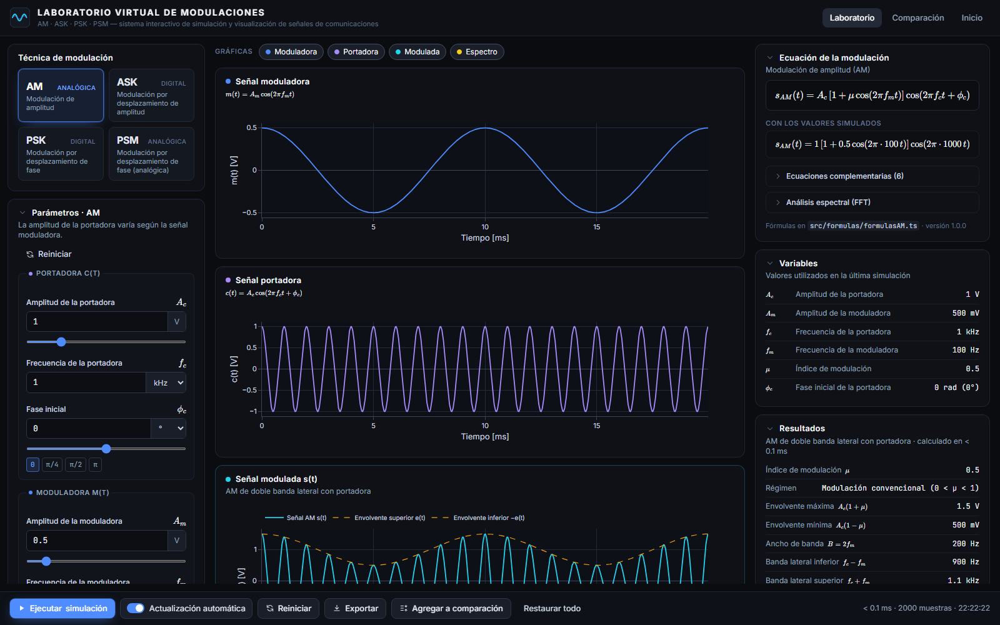
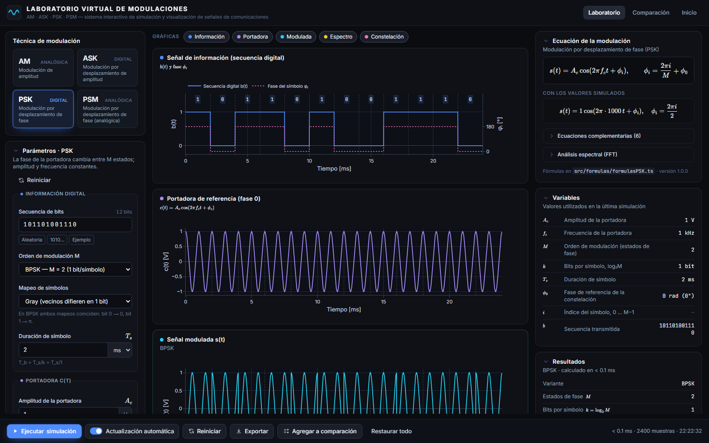

<div align="center">


# Laboratorio Virtual de Modulaciones

Simula y visualiza modulaciones **AM**, **ASK**, **PSK** (BPSK, QPSK, 8-PSK, 16-PSK) y **PSM**.<br />
Las señales se calculan muestra a muestra a partir de sus ecuaciones y se muestran en el tiempo, en frecuencia (FFT) y en el plano I/Q.

**[Abrir el laboratorio en línea →](https://laboratorio-modulaciones.vercel.app/laboratorio)** · [laboratorio-modulaciones.vercel.app](https://laboratorio-modulaciones.vercel.app)


</div>



### Abrir una técnica directamente

| Técnica | Qué se ve | Enlace |
|---|---|---|
| **AM** | Envolvente, sobremodulación, portadora y bandas laterales | [`/laboratorio?tecnica=AM`](https://laboratorio-modulaciones.vercel.app/laboratorio?tecnica=AM) |
| **ASK** | OOK, amplitud por bit, lóbulo espectral | [`/laboratorio?tecnica=ASK`](https://laboratorio-modulaciones.vercel.app/laboratorio?tecnica=ASK) |
| **PSK** | Saltos de fase, constelación I/Q, mapeo Gray | [`/laboratorio?tecnica=PSK`](https://laboratorio-modulaciones.vercel.app/laboratorio?tecnica=PSK) |
| **PSM** | Frecuencia instantánea, rayas de Bessel, regla de Carson | [`/laboratorio?tecnica=PSM`](https://laboratorio-modulaciones.vercel.app/laboratorio?tecnica=PSM) |



## Puesta en marcha

Requiere Node.js 20 o superior.

```bash
git clone https://github.com/RafaelC26/laboratorio-modulaciones.git
```

```bash
cd laboratorio-modulaciones
```

```bash
npm install
```

```bash
npm run dev
```

Abra http://localhost:3000 y pulse **Entrar al laboratorio** (o vaya directamente a `/laboratorio`).

### Despliegue

El proyecto está conectado a Vercel: cada `git push` a `main` publica una nueva versión en https://laboratorio-modulaciones.vercel.app (las demás ramas generan vistas previas).

Otros comandos:

| Comando | Qué hace |
|---|---|
| `npm test` | Ejecuta las pruebas matemáticas (`src/pruebas`). |
| `npm run typecheck` | Verifica los tipos de TypeScript. |
| `npm run build` y `npm start` | Compila y sirve la versión de producción. |

## Qué permite hacer

- Elegir la técnica y configurar sus parámetros con validación en vivo (campos con unidades Hz/kHz/MHz, s/ms/µs, °/rad).
- Ver la señal moduladora (o la secuencia digital), la portadora y la señal modulada, con zoom sincronizado entre las tres.
- AM: envolvente y zonas de **sobremodulación** marcadas en rojo cuando μ > 1.
- PSK: fase de cada símbolo, límites de símbolo, etiquetas de bits, **constelación** y tabla de mapeo (binario o Gray).
- PSM: frecuencia instantánea y espectro de Bessel.
- Espectro por FFT exacta de N puntos (radix-2 o Bluestein), con ventanas rectangular, Hann, Hamming y Blackman, escala lineal o dB, y **marcadores teóricos** para contrastar.
- Modo dinámico (recalcula al cambiar un parámetro) o manual (botón **Ejecutar**, atajo `Ctrl + Enter`).
- Comparar hasta 6 simulaciones: tabla de resultados y superposición de señales y espectros con la misma escala.
- Exportar datos (CSV), parámetros y resultados (JSON), un reporte (Markdown) y las gráficas (PNG).
- Historial de simulaciones anteriores (guardado en el navegador).

## Dónde se cambian las fórmulas

Cada técnica tiene su archivo en `src/formulas/`. Ahí están **juntas** las funciones que se calculan y las ecuaciones LaTeX que se muestran:

| Técnica | Archivo |
|---|---|
| Portadora | `src/formulas/formulasPortadora.ts` |
| AM | `src/formulas/formulasAM.ts` |
| ASK | `src/formulas/formulasASK.ts` |
| PSK | `src/formulas/formulasPSK.ts` |
| PSM | `src/formulas/formulasPSM.ts` |
| Espectro (FFT, ventanas, normalización) | `src/formulas/formulasEspectro.ts` |

Para modificar, por ejemplo, la ecuación de AM, se edita `senalModuladaAM` y la definición `formulasAM.principal.ecuacion` en `formulasAM.ts`. No hace falta tocar componentes de React ni gráficas.

### Sobre PSM

En este curso, PSM es la **modulación de fase analógica** (Phase Shift Modulation, PM), la contraparte analógica de PSK del mismo modo que AM lo es de ASK:

```
s(t) = A_c · cos(2π f_c t + φ_c + k_p · m(t)),   m(t) = A_m · cos(2π f_m t),   β = k_p · A_m
```

Sus ecuaciones están en `src/formulas/formulasPSM.ts`; las señales auxiliares que se dibujan (frecuencia instantánea) salen de `src/motores/MotorModulacionPSM.ts`.

## Convenciones matemáticas

- Unidades internas SI: s, Hz, V, rad. Potencias normalizadas a R = 1 Ω.
- Muestreo: `t_n = t_0 + n/f_s`, `n = 0 … N−1`, con `N = round((t_f − t_0)·f_s)`. La frecuencia de muestreo es el parámetro principal.
- Validación: se rechaza `f_s ≤ 2·f_max` (Nyquist) y se avisa si `f_s < 10·f_max`. Máximo 400 000 muestras por señal.
- ASK/PSK: el bit (o símbolo) i ocupa `[i·T, (i+1)·T)`. Una muestra que cae justo en el límite pertenece al símbolo siguiente.
- ASK: la portadora de referencia usa la mayor de A₁ y A₀ (en OOK, A₁).
- PSK: `φ_i = 2πi/M + φ₀`. Los bits se agrupan de k = log₂M (el primero es el más significativo) y, si faltan, se completan con ceros. Con mapeo Gray, el índice i recibe el código Gray de i. La portadora de referencia se dibuja con fase 0.
- Constelación: `s(t) = I·cos(2πf_c t) − Q·sen(2πf_c t)`, con `I = A_c cos φ_i` y `Q = A_c sen φ_i`.
- Espectro de un lado: `A_k = 2|X[k]| / (N·G_c)` (1 en k = 0 y N/2), donde `G_c` es la ganancia coherente de la ventana. Un coseno de amplitud A que cae en un punto de la FFT mide A.

## Estructura del proyecto

```
src/
├── app/                 Páginas de Next.js (inicio y /laboratorio)
├── componentes/
│   ├── interfaz/        Encabezado, menú, paneles, pie, tarjetas
│   ├── modulaciones/    Selector de técnica, formularios AM/ASK/PSK/PSM, historial
│   ├── graficas/        Envoltorio de Plotly y gráficas de tiempo, espectro y constelación
│   ├── ecuaciones/      Ecuaciones KaTeX y tabla de variables
│   ├── resultados/      Resultados y tabla de símbolos
│   ├── comparacion/     Vista de comparación
│   └── controles/       Campos numéricos, frecuencia, amplitud, fase, tiempo, bits y barra de simulación
├── clases/              ConfiguracionSenal, ParametrosModulacion, SenalAnalogica, SenalDigital, MuestraSenal, ResultadoSimulacion
├── configuracion/       Valores predeterminados, límites, muestreo, colores de gráficas, interfaz
├── formulas/            Ecuaciones de cada técnica (único lugar donde se definen)
├── motores/             Motor matemático, un motor por técnica, muestreo, FFT y constelación
├── servicios/           Simulación, validación, gráficas, exportación, comparación y gestor de fórmulas
├── estado/              Estado global (Zustand)
├── hooks/               useConfiguracionModulacion, useParametros, useSimulacion, useGraficas
├── tipos/               Tipos de modulación, señales, gráficas, simulación y fórmulas
├── utilidades/          Conversión de unidades, validación numérica, decibelios, formato
└── pruebas/             Pruebas Vitest de fórmulas, muestreo, FFT y motor matemático
```

Flujo de una simulación: formulario → `useParametros` (estado) → `ServicioSimulacion` → `ServicioValidacion` → `MotorMatematico` → motor de la técnica → `ResultadoSimulacion` → `ServicioGraficas` → Plotly.

## Cómo agregar una técnica nueva (por ejemplo FSK)

1. Añadir `"FSK"` a `TipoModulacion` y su `EntradaFSK` en `src/tipos/tiposModulacion.ts`.
2. Crear `src/formulas/formulasFSK.ts` y registrarlo en `src/formulas/repositorioFormulas.ts`.
3. Crear `src/motores/MotorModulacionFSK.ts` (implementa `MotorModulacion`) y registrarlo en `MotorMatematico`.
4. Agregar valores predeterminados y la descripción en `src/configuracion/configuracionGeneral.ts`, y su conversión en `ParametrosModulacion.desdeEntrada`.
5. Crear `FormularioFSK.tsx` y añadirlo en `PanelParametros.tsx`.
